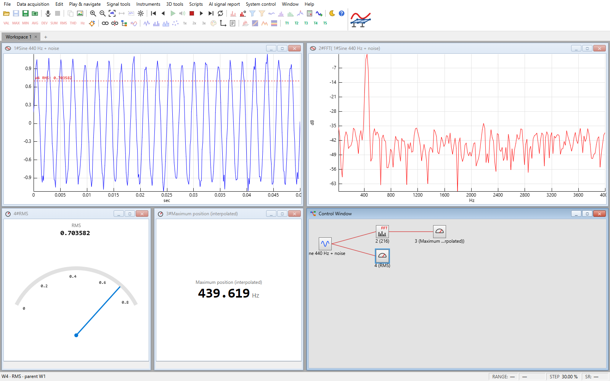
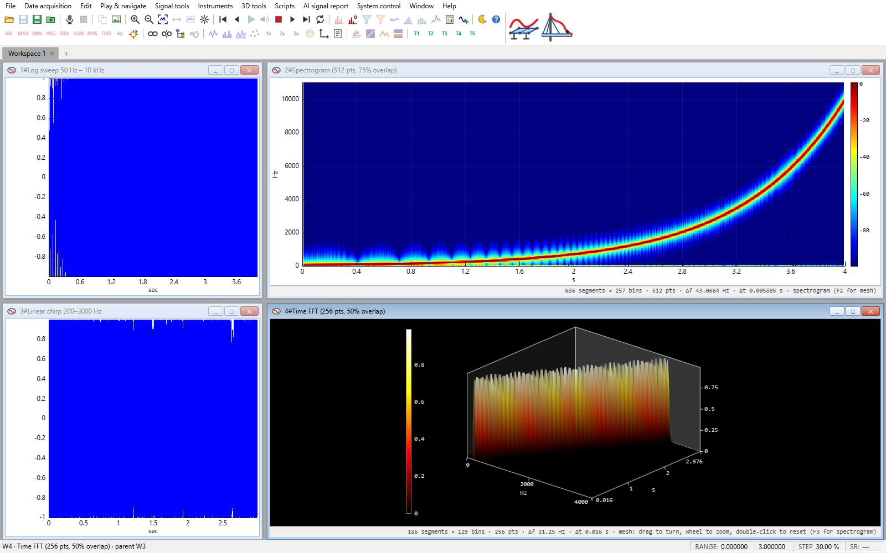
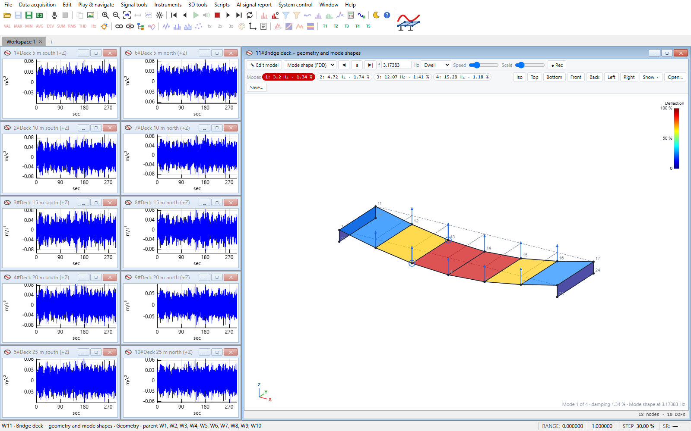
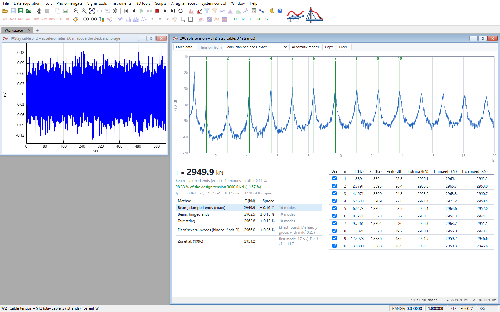
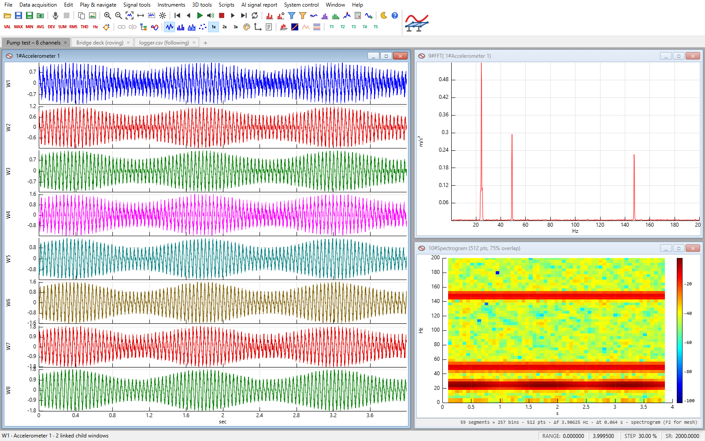
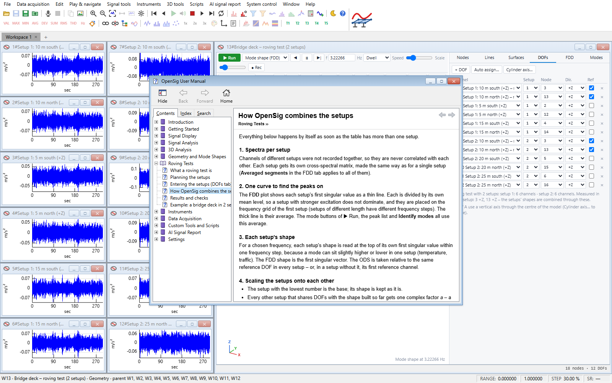
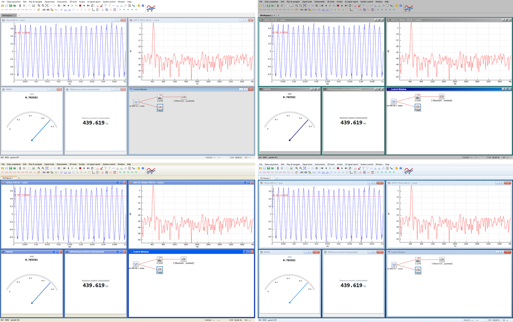
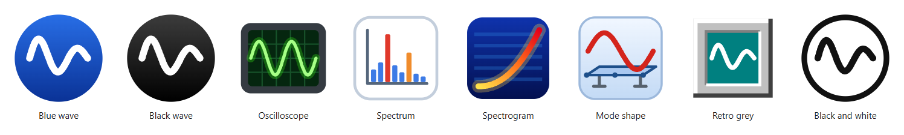
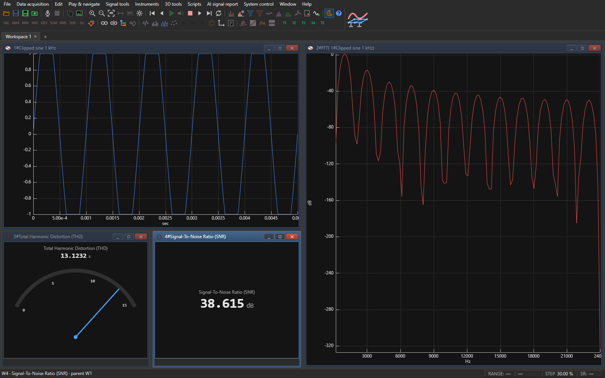

# OpenSig

**A signal analysis workbench built on linked windows.** Open a signal, and every FFT, spectrogram, filter or
instrument you make from it becomes a child window that recalculates as soon as you zoom, play or change its parent.
OpenSig runs in the browser, as a Windows desktop app (`OpenSig.exe`) and as a Mac app – everything is computed on your
own computer.


*A signal with its FFT, an RMS gauge and a frequency meter. The Control Window draws the analysis graph – every window
is a child of the one it was made from.*

## Screenshots

### Spectrograms and time FFT

*Spectrogram of a logarithmic sweep (top) and a time-FFT mesh view of a linear chirp (bottom), next to their source
signals.*

### Operational modal analysis

*A bridge deck measured with ten accelerometers: the 3D model animates each mode shape, and the mode buttons show the
natural frequency and damping found by Enhanced FDD.*

### Cable tension

*The tension of a stay cable from an accelerometer on it: the cable's harmonic series in the spectrum, the tension by
five methods – taut string, hinged or clamped beam, a fit of several modes and Zui et al. (1996) – and the ratio to
the design tension.*

### Workspace tabs and many channels

*Every workspace has its own tab. Eight channels share one window and one time axis (stacked view), with an FFT and a
spectrogram of the first channel.*

### Built-in user manual

*Help ▸ Contents, Index and Search, laid out like a Windows help viewer. F1 opens the page for the window or tab you
are using.*

### Window styles

*Window ▸ Window style: Standard (top left), Classic grey from the 1990s (top right), Classic blue from the 2000s
(bottom left) and Glass from the late 2000s (bottom right). The graphs look the same in every style.*

### App icons

*File ▸ Application settings ▸ App icon: the logo on the welcome screen, in About and in the browser tab, and – in the
Windows desktop app – the window and taskbar icon.*

### Dark mode

*Harmonic distortion of a clipped sine: its spectrum, a THD gauge and the signal-to-noise ratio, in dark mode.*

## What it does

- **Linked analysis windows** – FFT, spectrogram, filters and instruments follow their parent's visible part, so
  zooming or playing (F5) animates everything below it. The Control Window shows and edits the whole analysis graph –
  connect windows by dragging between their ports, add analyses and calculation nodes (a formula over any number of
  wired-in windows), zoom, fold branches, see live pictures –
  and Window ▸ Organize lays the windows out by signal – automatically, if you like.
- **Spectral analysis** – FFT / PSD with 15 window functions, zero padding, segment and complex averaging, smoothing,
  dB / dBFS, Siegel's test, A / C weighting; octave and 1/3 – 1/12 octave bands; spectrograms and time-FFT meshes
  with 3D cursors and slices.
- **Filters and calculations** – FFT and IIR filters, smoothing, a signal calculator with expressions over windows,
  cross-spectra, correlation and custom display windows.
- **Instruments** – more than 30 single-value meters (RMS, peak, THD, SNR, dominant frequency, statistics …) shown as
  numbers or gauges, with critical ranges, alarm actions and value logging; peak detection with six methods.
- **Operational modal analysis** – a 3D geometry editor, ODS and FDD animation, natural frequencies and damping by
  Enhanced FDD, MAC, roving tests measured in several setups, and Excel export of the results.
- **Cable tension** – the tension of stay cables and hangers from an accelerometer: the harmonic series found in the
  spectrum, five methods (taut string, hinged or clamped beam, a multi-mode fit that finds EI, Zui et al. 1996), the
  bending and sag parameters and the ratio to the design tension, with every step of the calculation shown with the
  cable's numbers; it reuses the spectrum windows a signal already has.
- **Workspaces** – every workspace in its own tab, saved with or without data and restored at the next start; custom
  tools, scripts, overlays and stacked views.
- **Videos in step with signals** – open a video (MP4, WebM, MOV …) and its sound, or attach a camera's video to
  any recording with an offset: it plays, scrubs and steps with the signal.
- **Data in and out** – WAV, FLAC, MP3, OGG, AIFF, M4A, CSV (millions of rows, and files that another program keeps
  writing), raw binary, MATLAB, NumPy, EDF / BDF / GDF, HDF5, UFF / UNV; live audio input; UDP / TCP and serial input
  in the desktop app; export to CSV, WAV, PNG and Excel.
- **A complete user manual** inside the app, with the formulas behind every spectral analysis, and a classic Windows
  look in four window styles – standard, 1990s grey, 2000s blue and glass – with a dark mode, and a choice of eight app
  icons.

The detailed feature list, file formats, automation commands and technical notes are in
[`opensig/README.md`](opensig/README.md).

## Getting started

### In the browser

Serve the `opensig` folder and open <http://127.0.0.1:8731> (serving it, rather than opening `index.html`
directly, lets live audio input work):

```bash
python -m http.server 8731 --bind 127.0.0.1 --directory opensig
```

Then try **Help ▸ Examples**, or drop a WAV or CSV file on the desktop area.

### Windows desktop app

`OpenSig.exe` is a single 64-bit file for Windows 10/11 that embeds the web app and adds native file dialogs, logging
to folders, network and serial input, batch processing and command-line automation. It builds with what ships with
Windows (the .NET Framework compiler and the Edge WebView2 runtime):

```bash
powershell -ExecutionPolicy Bypass -File desktop/build.ps1
```

This writes `desktop/dist/OpenSig.exe`. To build the installer (`OpenSig-Setup.exe`, with Start menu entry and file
associations) as well:

```bash
powershell -ExecutionPolicy Bypass -File desktop/build-installer.ps1
```

### Mac

On a Mac with Apple's command line tools (`xcode-select --install`), build `OpenSig.app` from the repository:

```bash
bash mac/build-mac.sh
```

See [`mac/README.md`](mac/README.md) for details.

### Tests

```bash
node --test opensig/test/*.test.js
```

## Repository layout

| Folder | Contents |
|---|---|
| [`opensig/`](opensig) | The app: `index.html`, `css/`, `js/` (one module per area – DSP, plotting, windows, geometry, help …), tests |
| [`desktop/`](desktop) | The Windows host (`Program.cs`, WebView2), the installer and their build scripts |
| [`mac/`](mac) | The macOS wrapper (`main.swift`, WebKit) and its build script |
| [`docs/screenshots/`](docs/screenshots) | The pictures in this README |
